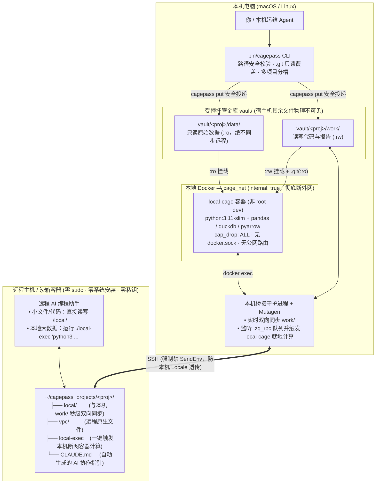

<div align="center">

# CagePass

**不开门，只递信 —— 让远程 AI 编程助手安全操作你本机的隔离数据**

*Keep private datasets locked inside a local offline Docker vault while your remote coding agent writes code, triggers local execution via `./local-exec`, and receives synced results.*

<p>
  <a href="LICENSE"></a>
  
  
  
</p>


**[Agent 自动接入指南](AGENT-GUIDE.md) · [配置模板](cagepass.example.yaml) · [安全护栏](#四层安全护栏) · [日常使用手册](#日常使用手册)**

</div>

---

## 推荐用法：让你的本机 AI Agent 帮你一键接入

如果你或你的团队成员正在使用本机 AI 编程助手（Antigravity / Cursor / Claude / Codex 等），**不需要手动折腾配置**。克隆本仓库后，直接把下面这句话发给你的本机 Agent：

```text
请先阅读本仓库根目录的 AGENT-GUIDE.md，作为我的 CagePass 本机运维 Agent，一步步帮我检查环境、完成配置，并接入我的第一个项目。
```

本机 Agent 会按 [AGENT-GUIDE.md](AGENT-GUIDE.md) 自动完成依赖探测、初始化、断网隔离验收与端到端自检，并在日后充当你的**本地文件投递与多项目管家**。

---

## 解决什么问题？

当你把 AI 编程助手（如 Claude Code）运行在远程主机或受限容器环境中（**无 `sudo`、禁装系统软件、运行在独立沙箱内**）时，CagePass 帮你同时解决三大痛点：

| 痛点 | CagePass 的解法 |
| :--- | :--- |
| **原始/敏感/GB 级数据不能传去远程硬盘** | 放在本机 `vault/<项目>/data/`，以只读（`:ro`）挂进**彻底断外网**的本地 Docker 容器，**100% 不出本机** |
| **远程 AI 在沙箱容器里，连不到宿主机端口/Socket** | 创新采用基于同步目录的 **`./local-exec` 文件 RPC**——零远程私钥、零常驻反向端口，穿透任意远程容器沙箱 |
| **同时推进多个项目，容易串台或卡顿** | 一套本地底座承载 N 个项目分槽；代码与报告由本机 **Mutagen** 实时双向同步，远程原生读写零卡顿 |

---

## 整体架构



---

## 手动快速开始

### 1. 本机前置依赖（远程无需安装任何软件）
- **Python 3.9+**（需安装 `PyYAML`：`pip3 install pyyaml`）
- **Docker**（macOS 推荐 OrbStack 或 Docker Desktop）
- **Mutagen**（仅本机安装）：
  ```bash
  brew install mutagen-io/mutagen/mutagen
  mutagen daemon start
  ```
- 本机 `~/.ssh/config` 中已配置好可免密登录的远程主机别名（如 `my-remote-host`）。

### 2. 初始化与启动首个项目

```bash
# 克隆仓库
git clone https://github.com/zeqi-git/CagePass.git
cd CagePass

# 1. 初始化配置（生成私有 zq-vpc.yaml，已被 .gitignore 忽略）
./bin/cagepass init
# 编辑 zq-vpc.yaml，将 remote.ssh_host 改为你的 SSH 别名，按需修改 remote.base_dir

# 2. 创建项目槽位
./bin/cagepass project add proj-a

# 3. 投递本地文件
./bin/cagepass put /path/to/raw_data.csv -p proj-a --ro   # 放入只读数据区（绝不同步远程）
./bin/cagepass put /path/to/scripts      -p proj-a --rw   # 放入读写工作区（双向实时同步）

# 4. 启动本地断网容器、RPC 守护进程与 Mutagen 同步
./bin/cagepass up

# 5. 运行全方位安全与连通性自检
./bin/cagepass doctor
```

---

## 日常使用手册

| 场景 | 本机操作 | 远程操作 |
| :--- | :--- | :--- |
| **每天开工** | `./bin/cagepass up` | 登录远程进入项目目录，启动你的远程 AI 会话 |
| **新开多项目** | `./bin/cagepass project add proj-b && ./bin/cagepass up` | 在 `tmux` 新窗口切到 `proj-b` 目录并行开工 |
| **投放敏感/大文件** | `./bin/cagepass put <文件> -p proj-a --ro` | 远程硬盘无副本，AI 运行 `./local-exec "python3 ..."` 就地分析 |
| **拿回分析产出** | 直接打开 `vault/proj-a/work/` 查看同步回来的报告 | AI 将报告写入 `/workspace/proj-a/work/` 或 `./local/` |
| **进入本地容器调试** | `./bin/cagepass shell proj-a` | — |
| **暂停单项目 / 收工** | `./bin/cagepass project stop proj-b` 或 `./bin/cagepass down` | 立即断开共享，本地 `vault/` 数据完整保留 |

---

## 四层安全护栏

1. **目录白名单 + 分级读写**：仅挂载受控金库 `vault/<project>/{data:ro, work:rw}` 与显式白名单目录，宿主机其余文件物理不可见。
2. **高危路径拦截**（借鉴 [Claude-Cage](https://github.com/Lee-xeo/Claude-Cage)）：启动前解析 `realpath` + 大小写折叠（适配 macOS APFS 大小写不敏感），强制拒绝挂载 `/`、`$HOME`、`~/.ssh`、`~/.claude`、系统目录及 `.state/`。
3. **`.git` 等 VCS 目录自动只读覆盖**：自动扫描 `:rw` 目录内的 `.git` / `.hg` / `.sl` / `.jj` 并覆盖挂载为 `:ro`，防止远程篡改 `.git/hooks` 或 `.git/config` 在宿主机触发命令执行。
4. **本地断网 + 防环境泄露**：`local-cage` 仅连 `internal: true` 内部网络（`cap_drop: ALL`、`no-new-privileges:true`、非 root `dev` 运行、绝不挂 `docker.sock`）；所有出站 SSH 命令强制 `-o SendEnv=-*` 屏蔽本机 Locale 透传。

---

## 开发与测试

```bash
python3 -m pytest -v
```

## 开源许可

本项目基于 [MIT License](LICENSE) 开源。
