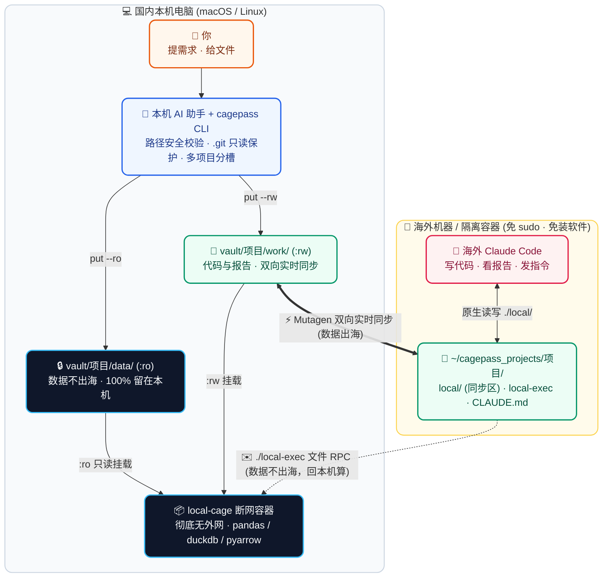

<div align="center">

# CagePass

**海外的 Claude 负责想，国内的 AI 帮你跑腿 —— 数据不用出国，电脑不用开门**

<p>
  <a href="LICENSE"></a>
  
  
  
</p>


**[交给本机 AI 一键接入](AGENT-GUIDE.md) · [配置示例](cagepass.example.yaml) · [安全保护](#怎么保证你电脑的安全) · [日常怎么用](#日常怎么用)**

</div>

---

## 为什么要做 CagePass

如果你把 Claude Code 放在海外机器上跑，大概率遇见过这种别扭事：

**干活的 Claude 在海外，但真正要分析的文件和几个 G 的数据，全躺在国内自己电脑里。**

把原始数据传去海外？传得慢、占硬盘、心里还不踏实；把本机直接打通给海外？万一 AI 误操作，自己电脑里的其他文件和密钥都在裸奔；每次新开项目还要自己折腾同步和容器，更是麻烦。

所以我们做了 **CagePass**，思路很简单——**让两个 AI 分工配合**：

* **海外的 Claude Code**：继续老老实实待在海外隔离环境里，专注想方案、写代码、看结果。
* **国内你本机的 AI 助手**（Antigravity / Cursor / Codex 等）：帮你管好本机一个**彻底断网的 Docker 容器**，平时你要传文件、开新项目、收工停机，直接跟本机 AI 说一声就行。

海外 Claude 需要算本地数据时，不用把数据拷出国，只通过一条 `./local-exec` 把命令递回来，在你本机断网容器里就地跑完，再把算好的报告传回去。**不开门，只递信。**

> **关于海外 Claude Code 的前提**：CagePass 不绑定某种特定的海外部署方式——不管你的 Claude Code 跑在自己的海外 VPS/Mac、团队托管的隔离容器，还是 [Claude-Cage](https://github.com/Lee-xeo/Claude-Cage) 这类环境里，只要本机能 SSH 连上去就能直接用（海外 CC 怎么搭这里不展开，CagePass 只负责把本机数据安全接过去）。

---

## 两套数据模式：出海 vs. 不出海，按需混用

同一个项目里，你可以按文件的敏感度和体积自由决定走哪条路：

| 模式 | 本机目录 / 投递参数 | 海外硬盘有没有原文件？ | 适合放什么 | 怎么工作 |
| :--- | :--- | :--- | :--- | :--- |
| **数据不出海（本地就地算）** | `vault/<项目>/data/`<br>（`--ro` 只读） | **完全没有**<br>（100% 留在本机） | 敏感原始数据、商业报表、几个 G 的大数据集 | 数据锁在本机断网容器里；海外 Claude 写好脚本后，用 `./local-exec` 递回本机就地算完，只传回汇总结果 |
| **数据出海（双向实时同步）** | `vault/<项目>/work/`<br>（`--rw` 读写） | **有同步副本**<br>（在海外 `./local/`） | 代码、分析脚本、脱敏后的小样本、最终报告 | 本机 Mutagen 1~2 秒双向实时同步，海外 Claude 直接原生读写，手感最丝滑 |

最常见的用法就是**混着用**：原始大表放 `data/` 不出海，让海外 Claude 写脚本放 `work/` 双向同步，再调 `./local-exec` 在本机断网容器里读 `data/` 算完，把报告写回 `work/` 同步两边一起看。

---

## 你可以用它做什么

* **数据留在自己电脑，照样让海外 Claude 干活。** 把敏感文件或几个 G 的原始数据放进本机只读区，海外硬盘不留副本；海外 Claude 写好脚本后，用 `./local-exec` 就能调你本机断网容器就地算完，只把汇总结果拿回去。
* **代码和报告两边秒级同步。** 需要一起改的脚本和产出放在工作区，1~2 秒双向同步，海外改完你电脑上立刻能看到，完全不卡。
* **把运维全甩给本机 AI。** 不用背命令、不用自己写 Docker 配置。把仓库里的 [AGENT-GUIDE.md](AGENT-GUIDE.md) 交给本机 AI，它会一步步帮你装好环境、配好项目；以后要传文件直接丢给它就行。
* **放心放权，不怕越界。** 本机容器只能看到你明确放进去的那几个文件夹，电脑上其他文件谁也看不到；容器彻底断外网，脚本绝对无法偷偷往外发数据；`.git` 目录自动只读保护。
* **海外机器零折腾。** 不用 `sudo`，不用在海外装任何软件，哪怕海外 Claude 自己也是关在隔离容器里跑的，一样直接能用。

---

## 最省事的用法：直接交给你的本机 AI

克隆完仓库，不用自己看文档，直接把下面这句话发给你电脑上的 AI 助手：

```text
请先阅读本仓库根目录的 AGENT-GUIDE.md，作为我的 CagePass 本机运维助手，一步步帮我检查环境、完成配置，并接入我的第一个项目。
```

它会自动帮你检查本机环境、配好容器和同步、跑完隔离自检，以后日常传文件和开新项目直接找它就行。

---

## 工作流程一览



---

## 如果你想自己手动跑

### 准备工作（只需要在本机装，海外什么都不用装）
* **Python 3.9+**（需要 `PyYAML`：`pip3 install pyyaml`）
* **Docker**（macOS 推荐 OrbStack 或 Docker Desktop）
* **Mutagen**：
  ```bash
  brew install mutagen-io/mutagen/mutagen
  mutagen daemon start
  ```
* 本机 `~/.ssh/config` 里已经配好能免密连上海外机器的 SSH 别名（比如 `my-remote-host`）。

### 几条命令跑起来

```bash
git clone https://github.com/zeqi-git/CagePass.git
cd CagePass

# 1. 初始化（会生成本地私有的 cagepass.yaml，不会被提交到 Git）
./bin/cagepass init
# 打开 cagepass.yaml，把 remote.ssh_host 改成你的 SSH 别名

# 2. 新建一个项目
./bin/cagepass project add proj-a

# 3. 往项目里放文件
./bin/cagepass put /path/to/raw_data.csv -p proj-a --ro   # 放只读数据区（只留本机，不传海外）
./bin/cagepass put /path/to/scripts      -p proj-a --rw   # 放工作区（和海外实时双向同步）

# 4. 启动本地断网容器和同步
./bin/cagepass up

# 5. 跑一次体检，确认断网隔离和连接都正常
./bin/cagepass doctor
```

---

## 日常怎么用

| 你想做什么 | 交给本机 AI（或自己敲） | 海外 Claude 这边 |
| :--- | :--- | :--- |
| **每天开工** | `./bin/cagepass up` | 连上海外进项目目录，打开 Claude Code |
| **同时开多个项目** | `./bin/cagepass project add proj-b && ./bin/cagepass up` | 在 `tmux` 里开新窗口切到 `proj-b` 并行干活 |
| **给海外算本机大文件** | `./bin/cagepass put <文件> -p proj-a --ro` | 海外硬盘没原文件，让 Claude 跑 `./local-exec "python3 ..."` 就地算 |
| **在本机看算好的报告** | 直接打开 `vault/proj-a/work/` | Claude 写进 `/workspace/proj-a/work/` 或 `./local/` 就会自动同步回来 |
| **进本地容器看一眼** | `./bin/cagepass shell proj-a` | — |
| **停掉某个项目 / 下班收工** | `./bin/cagepass project stop proj-b` 或 `./bin/cagepass down` | 共享立刻断开，本机 `vault/` 里的文件原封不动留着 |

---

## 怎么保证你电脑的安全

1. **只给看你点名的文件夹**：容器里只能看到 `vault/<项目>/` 和你明确加进白名单的目录，你电脑上的其他文件夹、桌面、文档、`~/.ssh` 统统看不到。
2. **拦截危险路径**（参考了 [Claude-Cage](https://github.com/Lee-xeo/Claude-Cage) 的做法）：启动前会解析软链接并处理 macOS 大小写问题，防止不小心把 `/`、`$HOME`、`~/.ssh`、`~/.claude` 或配置目录挂进去。
3. **保护 `.git` 不被篡改**：工作区里的 `.git` / `.hg` 等目录会自动覆盖为只读，防止海外修改 git hook 导致你在本机敲 git 时误触发命令。
4. **本地容器彻底断网 + 不泄露本机语言环境**：`local-cage` 放在 `internal: true` 内部网络里，完全连不上公网，也不能用 `root` 或 `docker.sock`；所有出站 SSH 默认关闭 `SendEnv`，不把本机中文语言环境带去海外。

---

## 跑测试

```bash
python3 -m pytest -v
```

## 许可

[MIT License](LICENSE)
