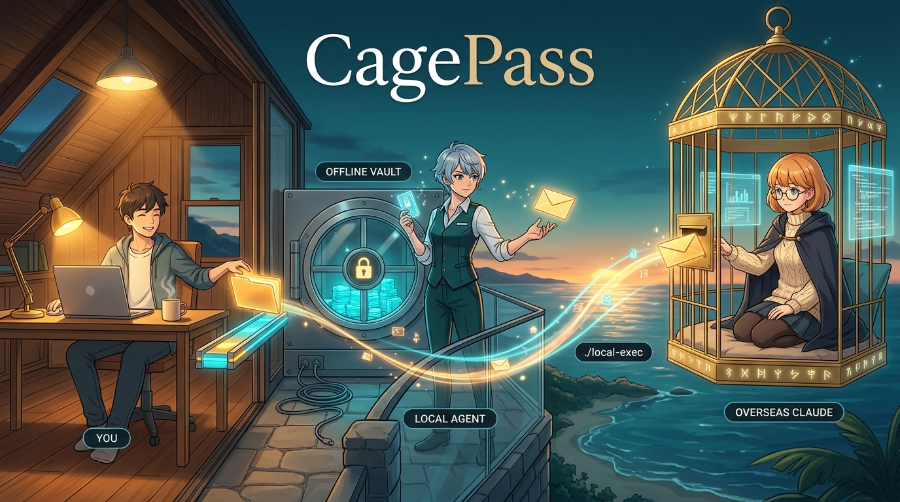
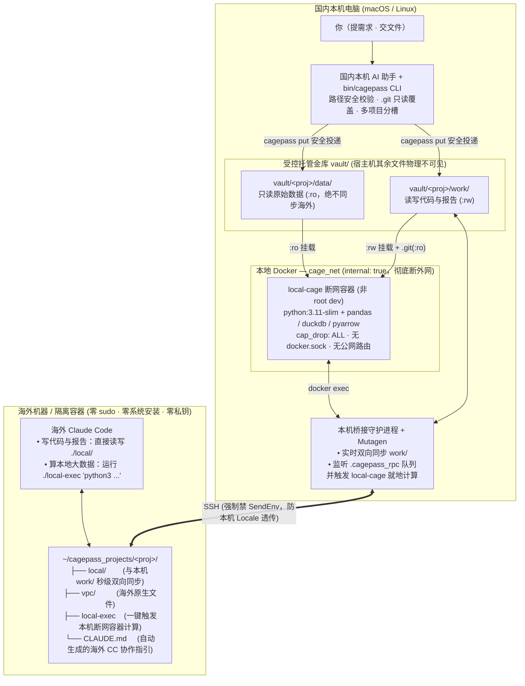

<div align="center">

# CagePass

**海外 Claude Code 专注思考与写代码 × 国内本机 AI 助手守住断网金库与数据调度**

*Dual-AI Collaboration: Keep Claude Code safely in its overseas environment while your local AI assistant manages an offline Docker vault, stages private data, and executes local jobs through `./local-exec`.*

<p>
  <a href="LICENSE"></a>
  
  
  
</p>



**[本机 AI 一键接入指南](AGENT-GUIDE.md) · [配置模板](cagepass.example.yaml) · [安全护栏](#四层安全护栏) · [日常使用手册](#日常使用手册)**

</div>

---

## 核心理念：双 AI 分工，数据不出本地

很多团队在使用 Claude Code 时都面临同一个矛盾：**Claude Code 部署在海外机器（通常是无 `sudo`、容器隔离的托管环境），而真实业务数据、敏感文件或 GB 级数据集留在国内本机电脑上。**

**CagePass** 提出一种 **“海外 CC + 国内本机 AI” 双 Agent 协同模式**：

* **海外 Claude Code（云端大脑）**：稳稳留在海外合规隔离环境里，专注架构设计、写代码、做分析与生成报告，不碰你的本机宿主机，也不需要把原始数据拷到海外硬盘。
* **国内本机 AI 助手（本机管家）**：由你电脑上的本地 AI（如 Antigravity / Cursor / Codex 等）担任，接管 `CagePass` 的全部本地运维——帮你启停断网 Docker、做安全路径审计、把文件投递进只读金库或读写同步区，并排查连接状态。
* **你（决策者）**：只需把数据交给你本机的 AI 助手，然后去海外 Claude Code 下达分析/开发指令，**不开门、只递信**。

| 传统痛点 | CagePass 的解法 |
| :--- | :--- |
| **原始/敏感/GB 级数据不能传出国** | 锁进本机 `vault/<项目>/data/`，以只读（`:ro`）挂入**彻底断外网**的本地 Docker 容器，**100% 留在本机** |
| **海外 CC 跑在沙箱容器里，连不到外部端口** | 采用基于同步目录的 **`./local-exec` 文件 RPC**——零海外私钥、零常驻反向隧道，天然穿透任意远程容器沙箱 |
| **本地运维繁琐、多项目容易串台** | 配套 [AGENT-GUIDE.md](AGENT-GUIDE.md)，把本机配置、投递与多项目分槽全部交给你的国内本机 AI 助手代劳 |

---

## 1 句话启动：让你的本机 AI 助手帮你接管

克隆本仓库后，**无需手动啃配置**，直接把下面这句话发给你的国内本机 AI 助手：

```text
请先阅读本仓库根目录的 AGENT-GUIDE.md，作为我的 CagePass 本机运维 Agent，一步步帮我检查环境、完成配置，并接入我的第一个项目。
```

本机 AI 会自动完成环境探测、配置生成、断网隔离验收与端到端自检，并从此刻起担任你的日常本机管家。

---

## 整体架构



---

## 手动快速开始

### 1. 本机前置依赖（海外机器无需安装任何软件）
- **Python 3.9+**（需安装 `PyYAML`：`pip3 install pyyaml`）
- **Docker**（macOS 推荐 OrbStack 或 Docker Desktop）
- **Mutagen**（仅本机安装）：
  ```bash
  brew install mutagen-io/mutagen/mutagen
  mutagen daemon start
  ```
- 本机 `~/.ssh/config` 中已配置好可免密登录海外主机的 SSH 别名（如 `my-remote-host`）。

### 2. 初始化与启动首个项目

```bash
git clone https://github.com/zeqi-git/CagePass.git
cd CagePass

# 1. 初始化配置（生成本地私有 cagepass.yaml，已被 .gitignore 忽略）
./bin/cagepass init
# 编辑 cagepass.yaml，将 remote.ssh_host 改为你的 SSH 别名，按需修改 remote.base_dir

# 2. 创建项目槽位
./bin/cagepass project add proj-a

# 3. 投递本地文件
./bin/cagepass put /path/to/raw_data.csv -p proj-a --ro   # 放只读数据区（100% 留在本机）
./bin/cagepass put /path/to/scripts      -p proj-a --rw   # 放读写工作区（双向实时同步）

# 4. 启动本地断网容器、RPC 守护进程与 Mutagen 同步
./bin/cagepass up

# 5. 运行安全隔离与连通性自检
./bin/cagepass doctor
```

---

## 日常使用手册

| 场景 | 交给本机 AI（或手动执行） | 海外 Claude Code 侧 |
| :--- | :--- | :--- |
| **每天开工** | `./bin/cagepass up` | 登录海外进入项目目录，打开 Claude Code |
| **新开多项目** | `./bin/cagepass project add proj-b && ./bin/cagepass up` | 在 `tmux` 新窗口切到 `proj-b` 目录并行开工 |
| **投放敏感/大文件** | `./bin/cagepass put <文件> -p proj-a --ro` | 海外硬盘无副本，CC 运行 `./local-exec "python3 ..."` 就地分析 |
| **拿回分析产出** | 直接在 `vault/proj-a/work/` 查看同步回来的报告 | CC 将报告写入 `/workspace/proj-a/work/` 或 `./local/` |
| **进入本地容器调试** | `./bin/cagepass shell proj-a` | — |
| **暂停单项目 / 收工** | `./bin/cagepass project stop proj-b` 或 `./bin/cagepass down` | 立即断开共享，本地 `vault/` 数据完整保留 |

---

## 四层安全护栏

1. **目录白名单 + 分级读写**：仅挂载受控金库 `vault/<project>/{data:ro, work:rw}` 与显式白名单目录，宿主机其余文件物理不可见。
2. **高危路径拦截**（借鉴 [Claude-Cage](https://github.com/Lee-xeo/Claude-Cage)）：启动前解析 `realpath` + 大小写折叠（适配 macOS APFS 大小写不敏感），强制拒绝挂载 `/`、`$HOME`、`~/.ssh`、`~/.claude`、系统目录及 `.state/`。
3. **`.git` 等 VCS 目录自动只读覆盖**：自动扫描 `:rw` 目录内的 `.git` / `.hg` / `.sl` / `.jj` 并覆盖挂载为 `:ro`，防止远程篡改 `.git/hooks` 或 `.git/config` 在宿主机触发命令执行。
4. **本地断网 + 防环境泄露**：`local-cage` 仅连 `internal: true` 内部网络（`cap_drop: ALL`、`no-new-privileges:true`、非 root `dev` 运行、绝不挂 `docker.sock`）；所有出站 SSH 命令强制 `-o SendEnv=-*` 屏蔽本机 Locale 透传。

---

## 开发与测试

```bash
python3 -m pytest -v
```

## 开源许可

本项目基于 [MIT License](LICENSE) 开源。
